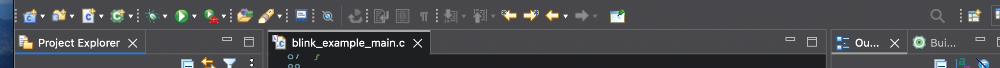
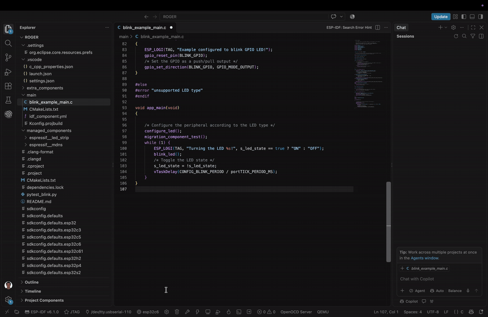
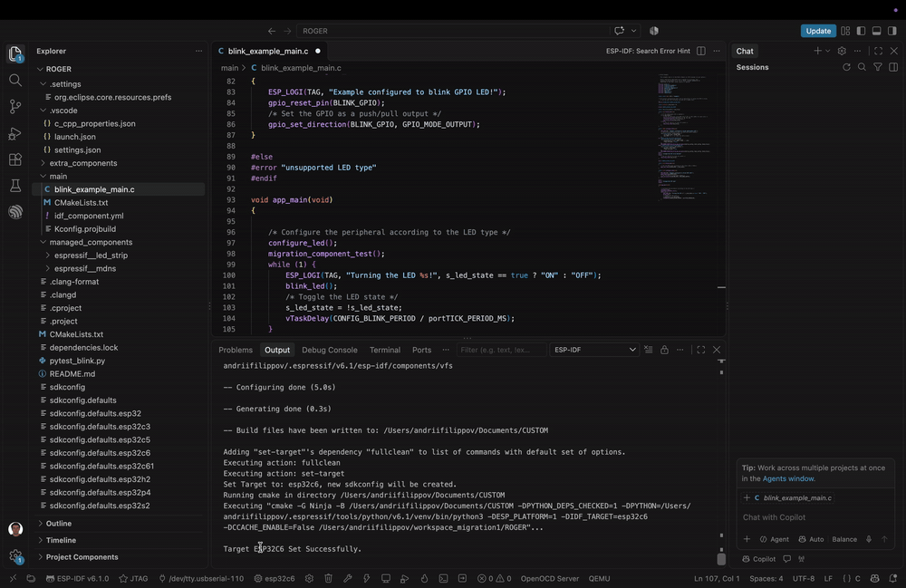
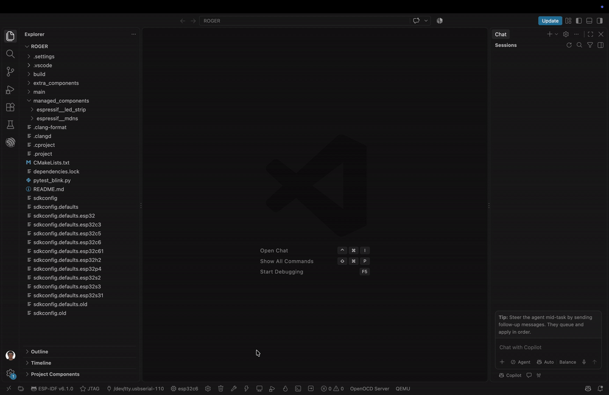
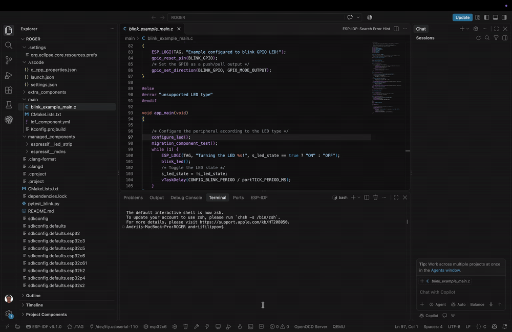

# Migrating from Espressif-IDE to the ESP-IDF VS Code Extension

> A practical migration guide for existing Espressif-IDE / ESP-IDF Eclipse Plugin users.

Espressif-IDE 4.5.0 is the final feature release of Espressif-IDE and the ESP-IDF Eclipse plugin. Existing users can continue to maintain current projects, but new projects are encouraged to use the ESP-IDF VS Code Extension.

This guide shows how to open an existing ESP-IDF project in VS Code and reproduce the workflows you already know from Espressif-IDE: configure, build, flash, monitor, and debug.

## What to expect

You do **not** need to recreate your ESP-IDF project.

Most project-level ESP-IDF configuration is portable and can be reused directly in VS Code. The parts that may need manual attention are mainly IDE-specific settings stored by Eclipse outside the project itself.

### Usually reusable without changes

- Source code and `CMakeLists.txt`
- `sdkconfig` and `sdkconfig.defaults*`
- `dependencies.lock`
- `idf_component.yml`
- Managed components
- Local/custom components
- `.clang-format` and `.clangd` when stored in the project

### May require manual setup

- Custom build directory
- JTAG / OpenOCD board configuration
- Adapter-specific settings
- VS Code debug configuration (`.vscode/launch.json`)
- Custom debug values from Eclipse `.launch` files
- Environment-specific build cache

> [!IMPORTANT]
> Keep the original Eclipse workspace, including its `.metadata` directory, until Build, Flash, Monitor, and Debug have all been verified in VS Code. Some Eclipse-specific settings are stored in the workspace rather than in the project directory.

---

## Eclipse to VS Code: quick reference

| Task | Espressif-IDE / Eclipse Plugin | ESP-IDF VS Code Extension |
|---|---|---|
| Open project | Import/open project in an Eclipse workspace | **File → Open Folder...** |
| Select target | Project/toolbar target configuration | ESP-IDF target/device selection from the status bar or Command Palette |
| Select flash method | Eclipse launch/flash configuration | Select **UART** or **JTAG** in the ESP-IDF status bar/settings |
| Select port | Serial configuration | Select the device port from the ESP-IDF status bar |
| Full Clean | Clean/reconfigure project | **ESP-IDF: Full Clean** |
| Build | Build toolbar / CDT Build | **ESP-IDF: Build your project** |
| Menuconfig | ESP-IDF SDK Configuration Editor | **ESP-IDF: SDK Configuration Editor (Menuconfig)** |
| Flash | Serial/JTAG flash action | **ESP-IDF: Flash your project** |
| Monitor | Serial Monitor | **ESP-IDF: Monitor your device** |
| Debug | Eclipse `.launch` configuration | Generate `.vscode` config if needed, then start Debug |

### Familiar controls, different locations

Espressif-IDE exposes many project actions through the Eclipse toolbar:



In VS Code, the same workflow is split between the **ESP-IDF status bar**, the **Command Palette**, and the **Run and Debug** view:


---

## Optional: AI-assisted migration

If your AI coding agent supports `AGENTS.md`, download the
[migration `AGENTS.md`](docs_readme/migration/AGENTS.md)
and place it in the root of your ESP-IDF project.

It provides migration-specific instructions for moving an existing project
from Espressif-IDE to the ESP-IDF VS Code Extension.

# Migration walkthrough

## 1. Open the existing project

In VS Code, use **File → Open Folder...** and select the root directory of your existing ESP-IDF project.


You do not need to create a new VS Code project or copy your source files into a new template.

After opening the folder, verify that the project still contains its normal ESP-IDF files, for example:

```text
project/
├── CMakeLists.txt
├── main/
├── sdkconfig
├── sdkconfig.defaults
├── dependencies.lock
├── managed_components/
└── ...
```

---

## 2. Verify the ESP-IDF setup

Make sure VS Code is using the ESP-IDF installation/version expected by the project.

If you already have the required ESP-IDF version installed, select that existing setup in the ESP-IDF extension rather than reinstalling the framework.

> [!TIP]
> Using the same ESP-IDF version first makes migration easier to validate. Upgrade the project separately after the IDE migration is complete.

---

## 3. Select the target and board

Select the ESP-IDF target used by the project and, when applicable, the exact board/device configuration.



> [!IMPORTANT]
> For JTAG users, explicitly select the board/device even if the chip target already appears correct. A correct `IDF_TARGET` does not necessarily mean the corresponding OpenOCD board configuration has been initialized.

For example, a project may correctly report `esp32c6` while VS Code still has an unrelated OpenOCD configuration from an older project. Re-selecting the target/board refreshes the project-specific hardware configuration.

---

## 4. Select the flash method

Choose the flash method that matches your existing workflow.


Typical choices are:

- **UART** for serial flashing
- **JTAG** when flashing through OpenOCD/JTAG

If you are migrating a JTAG-based workflow, verify this setting before troubleshooting OpenOCD or Debug.

---

## 5. Select the serial port

For UART flashing and Serial Monitor, select the device port.



The exact port name is platform-dependent, for example:

```text
macOS:   /dev/tty.usbserial-...
Linux:   /dev/ttyUSB0 or /dev/ttyACM0
Windows: COM3, COM4, ...
```

---

## 6. Run Full Clean only if needed

Do not clean the project automatically unless it is necessary. First try to use the existing project normally.

If Menuconfig or configuration fails because the inherited build cache references a different Python executable, ESP-IDF environment, or absolute path, run:

**ESP-IDF: Full Clean**



A validated migration case contained a CMake cache created with `.../python`, while the VS Code environment used `.../python3`. Full Clean removed the incompatible generated state and allowed the project to reconfigure successfully.

> [!NOTE]
> A full project Build is not required just to recover Menuconfig after this type of cache problem. Full Clean followed by reopening the SDK Configuration Editor can be enough.

---

## 7. Build the project

Run:

**ESP-IDF: Build your project**


The following project-level state should continue to work without IDE-specific conversion:

- custom CMake configuration
- `sdkconfig`
- `sdkconfig.defaults*`
- managed components
- local/custom components
- dependency lock files

If Build succeeds, this is a strong indication that the ESP-IDF project itself migrated correctly.

---

## 8. Open SDK Configuration Editor / Menuconfig

Run:

**ESP-IDF: SDK Configuration Editor (Menuconfig)**



Verify that important existing values are still present.

Examples include:

- target-specific configuration
- flash size
- partition table selection
- compiler optimization
- application-specific Kconfig values

If the editor reports that the project must be cleaned because of an incompatible build cache, return to **Step 6**.

---

## 9. Flash the project

After the target, flash method, and port/board are correct, run:

**ESP-IDF: Flash your project**


### UART users

UART flashing normally works once the correct serial port and target are configured.

### JTAG users

If JTAG Flash fails immediately with an OpenOCD adapter/device error, do not assume JTAG support is broken. First:

1. Re-select the target.
2. Select the exact board/device configuration.
3. Confirm the flash method is JTAG.
4. Verify the adapter/device selection when multiple boards are connected.

In migration testing, this restored the correct board OpenOCD configuration and JTAG Flash started working normally.

---

## 10. Start Serial Monitor

Run:

**ESP-IDF: Monitor your device**


Verify normal application output and confirm that the expected firmware is running.

This is also a convenient point to validate custom/local components because their runtime output can confirm that they were compiled, linked, flashed, and executed correctly.

---

## 11. Configure and start Debug

Existing Espressif-IDE projects do not necessarily contain a VS Code debug configuration.

If `.vscode/launch.json` is missing, run:

**ESP-IDF: Add VS Code Configuration Folder**

Then start Debug from the VS Code **Run and Debug** view.


Default debugging works after the VS Code configuration folder is generated.

> [!WARNING]
> `Add VS Code Configuration Folder` creates VS Code defaults. It does **not** convert your existing Eclipse `.launch` file. If your Eclipse debug setup contained custom ports, semihosting, reset behavior, custom GDB commands, or other non-default settings, review them manually after default Debug is working.

---

# Advanced migration cases

## Custom build directory

A custom build directory used by Espressif-IDE may be stored in the Eclipse launch configuration rather than in the portable project files.

For example:

```xml
<stringAttribute
    key="com.espressif.idf.launch.serial.core.idfBuildFolderPath"
    value="/path/to/custom-build"/>
```

VS Code supports a custom build directory, but this value is not currently imported automatically from Eclipse metadata.

If your project depends on a custom build path:

1. Configure the equivalent build directory in VS Code using the
   [`idf.buildPath`](https://github.com/espressif/vscode-esp-idf-extension/blob/master/docs_espressif/en/settings.rst#build)
   setting.

   For example:

   ```json
   {
       "idf.buildPath": "${workspaceFolder}/custom-build"
   }
   ```
2. Reconfigure or clean generated state if necessary.
3. Verify Menuconfig.
4. Verify Build.
5. Verify Flash.
6. Verify Debug.

This matters not only for compilation. External scripts and Clangd may also depend on files such as `compile_commands.json` generated inside the active build directory.

---

## JTAG / OpenOCD settings

Some JTAG state can be stored in the Eclipse workspace under `<workspace>/.metadata`, including adapter-specific values.

Examples found during migration testing included:

```text
OPENOCD_ADAPTER_SERIAL=...
OPENOCD_USB_ADAPTER_LOCATION=...
```

If the migrated project builds successfully but JTAG Flash does not:

1. Verify `IDF_TARGET`.
2. Re-select the board/device in VS Code.
3. Verify the OpenOCD board configuration.
4. Verify JTAG as the flash method.
5. Verify the intended adapter if multiple devices are connected.
6. Confirm JTAG Flash before troubleshooting the Debug configuration.

---

## Custom Eclipse debug configuration

Eclipse debug settings may be stored in:

```text
<workspace>/.metadata/.plugins/org.eclipse.debug.core/.launches/<project>.launch
```

Review the old `.launch` file if your workflow uses custom values such as:

- GDB port
- TCL port
- Telnet port
- `stopAt=app_main`
- semihosting
- flash-before-debug
- reset sequence
- custom GDB commands or timeouts

Start with a working default VS Code Debug configuration, then recreate only the custom behavior your project actually requires.

> [!CAUTION]
> Eclipse workspace metadata can contain stale or duplicated values. Do not blindly copy every target-related value into VS Code. Prefer the actual ESP-IDF project configuration when resolving conflicts.

---

## Local custom components

No migration-specific changes are required for local custom components that are already configured as part of the ESP-IDF project.

VS Code uses the same ESP-IDF/CMake project configuration, including settings such as `EXTRA_COMPONENT_DIRS`, so existing local components should continue to work without modification.

> **Note:** If a component is located outside the project and is referenced using an absolute path, verify that the path is still valid after migration.

---

## C/C++ code navigation and IntelliSense

Espressif-IDE uses clangd for C/C++ code navigation, diagnostics, and header resolution.

In VS Code, the default ESP-IDF setup uses the Microsoft C/C++ extension.

If you prefer to continue using clangd, install the clangd extension and run:

**ESP-IDF: Configure project for ESP-Clang**

See the [ESP-IDF VS Code Extension documentation](https://github.com/espressif/vscode-esp-idf-extension/blob/master/docs_espressif/en/configureproject.rst#c-and-c-code-navigation-and-syntax-highlighting) for more details.

---

# Troubleshooting

| Symptom | Likely cause | Recommended action |
|---|---|---|
| SDK Configuration Editor asks for `fullclean` | Existing CMake cache references another Python/environment | Run **ESP-IDF: Full Clean**, then reopen the editor. |
| JTAG Flash reports an FTDI/OpenOCD device error | Board/OpenOCD setup was not restored | Re-select target + exact board/device configuration. |
| Target appears correct but JTAG still fails | Chip target and board/OpenOCD state are separate | Explicitly select the board/device again. |
| Debug reports `.vscode/launch.json` is missing | Existing project has no VS Code debug config | Run **ESP-IDF: Add VS Code Configuration Folder**. |
| Default Debug works but behavior differs from Eclipse | Custom Eclipse `.launch` values were not converted | Review and recreate required custom debug settings. |
| VS Code creates `project/build` instead of the old build path | Eclipse custom build path was not imported | Configure the custom build directory manually. |
| Custom component header cannot be found | Incorrect `EXTRA_COMPONENT_DIRS`, folder layout, or stale cache | Verify CMake/component paths and reconfigure. |
| Doctor reports unrelated configuration errors | Stale user/global extension settings | Check whether the reported setting is relevant to the current project. |

---

# Final migration checklist

Use this checklist before considering the migration complete:

- [ ] Existing project opens directly in VS Code.
- [ ] Correct ESP-IDF installation/version is selected.
- [ ] Correct ESP-IDF target is selected.
- [ ] Correct board/OpenOCD configuration is selected for JTAG projects.
- [ ] Flash method is correct.
- [ ] Serial port is correct when UART/Monitor is used.
- [ ] SDK Configuration Editor opens successfully.
- [ ] Existing `sdkconfig` values are preserved.
- [ ] Project builds successfully.
- [ ] Local/custom/managed components are resolved.
- [ ] UART and/or JTAG Flash works for the intended workflow.
- [ ] Monitor shows expected runtime output.
- [ ] Custom build directory is restored if required.
- [ ] `.vscode/launch.json` exists for Debug users.
- [ ] Default Debug starts successfully.
- [ ] Custom Eclipse debug settings have been reviewed.

---

# Where Eclipse-specific configuration may live

Do not delete the original Eclipse workspace until migration validation is complete.

Useful locations include:

```text
<workspace>/.metadata/.plugins/org.eclipse.debug.core/.launches/<project>.launch
<workspace>/.metadata/.plugins/org.eclipse.core.runtime/.settings/org.eclipse.launchbar.core.prefs
<workspace>/.metadata/.plugins/org.eclipse.core.runtime/.settings/com.espressif.idf.debug.gdbjtag.openocd.prefs
<workspace>/.metadata/.plugins/org.eclipse.core.runtime/.settings/com.espressif.idf.launch.serial.ui.prefs
<workspace>/.metadata/.plugins/org.eclipse.core.runtime/.settings/org.eclipse.cdt.core.prefs
```

If only the project directory is available and the original Eclipse workspace has already been deleted, workspace-level debug/JTAG settings may no longer be recoverable automatically.

---

## Related resources

- [Espressif-IDE support status](README.md#support-status)
- [Espressif-IDE support policy](SUPPORT_POLICY.md)
- [ESP-IDF VS Code Extension](https://github.com/espressif/vscode-esp-idf-extension)
- [ESP-IDF Programming Guide](https://docs.espressif.com/projects/esp-idf/en/latest/)

