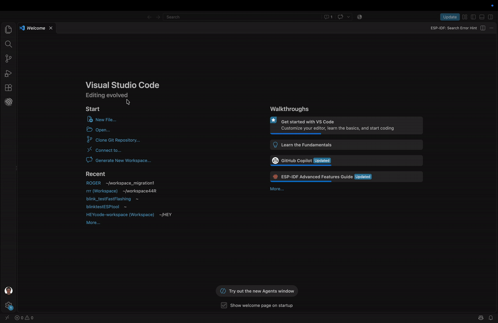
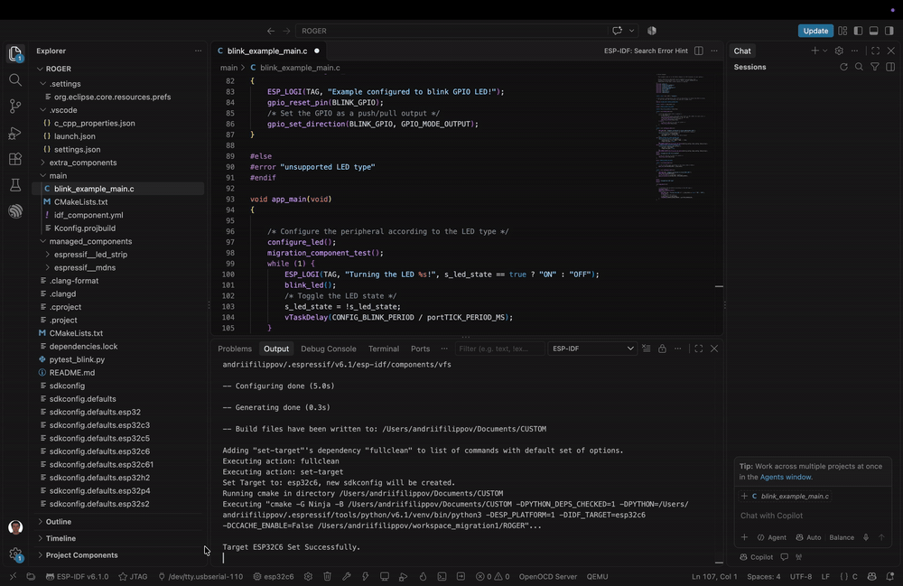
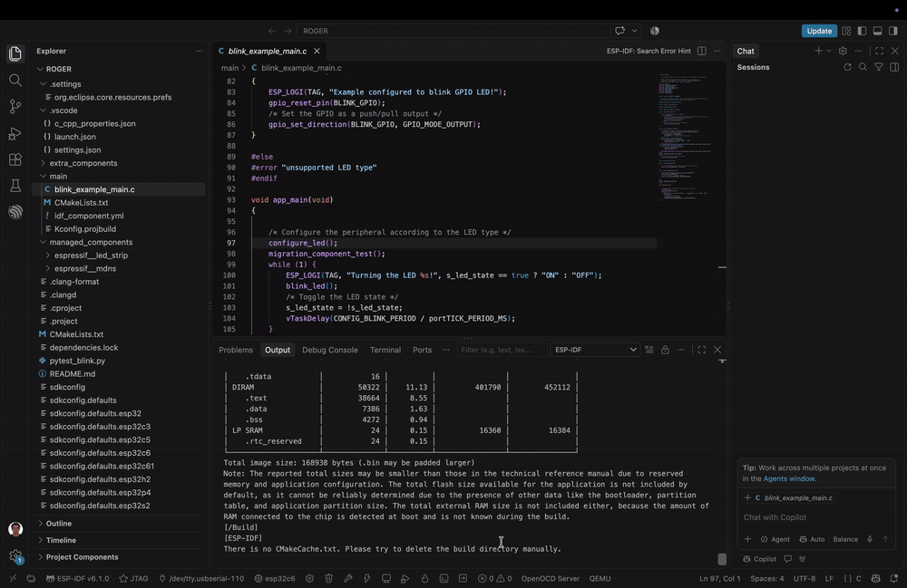
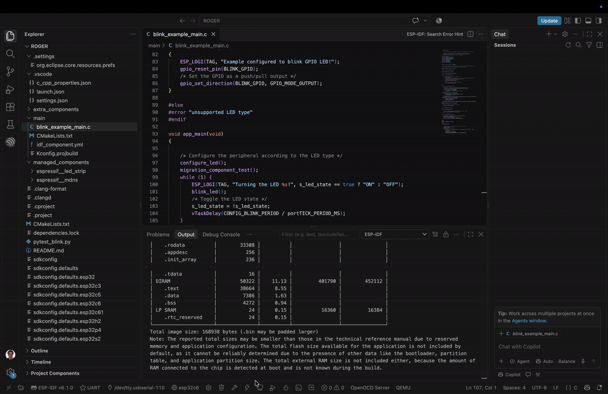
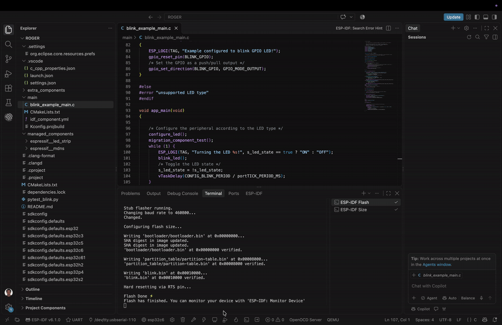
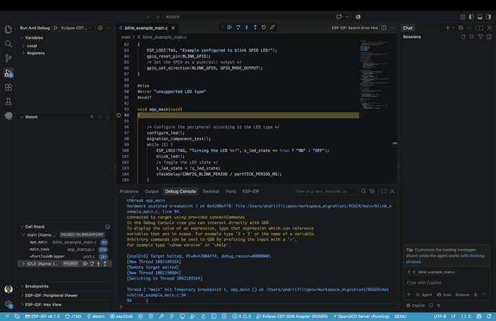

Migration walkthrough
=====================

:link_to_translation:`zh_CN:[中文]`

Open an existing ESP-IDF project in the ESP-IDF VS Code Extension and validate the same workflows you used in Espressif-IDE. See :doc:`migrate-to-vscode` for what is reused automatically and what still needs manual setup.

1. Open the existing project
----------------------------

In VS Code, use **File → Open Folder...** and select the root directory of your existing ESP-IDF project.

You do not need to create a new VS Code project or copy your source files into a new template.

After opening the folder, verify that the project still contains its normal ESP-IDF files, for example:

.. code-block:: text

   project/
   ├── CMakeLists.txt
   ├── main/
   ├── sdkconfig
   ├── sdkconfig.defaults
   ├── dependencies.lock
   ├── managed_components/
   └── ...

2. Verify the ESP-IDF setup
---------------------------

Make sure VS Code is using the ESP-IDF installation/version expected by the project.

If you already have the required ESP-IDF version installed, select that existing setup in the ESP-IDF extension rather than reinstalling the framework.

.. tip::

    Using the same ESP-IDF version first makes migration easier to validate. Upgrade the project separately after the IDE migration is complete.

3. Select the target and board
------------------------------

Select the ESP-IDF target used by the project and, when applicable, the exact board/device configuration.

.. image:: ../_static/migration/02_set_target.gif
   :alt: Set target and board

.. important::

    For JTAG users, explicitly select the board/device even if the chip target already appears correct. A correct ``IDF_TARGET`` does not necessarily mean the corresponding OpenOCD board configuration has been initialized.

For example, a project may correctly report ``esp32c6`` while VS Code still has an unrelated OpenOCD configuration from an older project. Re-selecting the target/board refreshes the project-specific hardware configuration.

4. Select the flash method
--------------------------

Choose the flash method that matches your existing workflow.

Typical choices are:

- **UART** for serial flashing
- **JTAG** when flashing through OpenOCD/JTAG

If you are migrating a JTAG-based workflow, verify this setting before troubleshooting OpenOCD or Debug.

5. Select the serial port
-------------------------

For UART flashing and Serial Monitor, select the device port.

.. image:: ../_static/migration/04_set_port.gif
   :alt: Set serial port

The exact port name is platform-dependent, for example:

.. code-block:: text

   macOS:   /dev/tty.usbserial-...
   Linux:   /dev/ttyUSB0 or /dev/ttyACM0
   Windows: COM3, COM4, ...

.. _migration-full-clean:

6. Run Full Clean only if needed
--------------------------------

Do not clean the project automatically unless it is necessary. First try to use the existing project normally.

If Menuconfig or project configuration fails because of stale or environment-specific build cache, run:

**ESP-IDF: Full Clean**

.. image:: ../_static/migration/05_full_clean.gif
   :alt: Full Clean

.. note::

    A full project Build is not required just to recover Menuconfig. Full Clean followed by reopening the SDK Configuration Editor can be enough.

7. Build the project
--------------------

Run:

**ESP-IDF: Build your project**

The following project-level state should continue to work without IDE-specific conversion:

- custom CMake configuration
- ``sdkconfig``
- ``sdkconfig.defaults*``
- managed components
- local/custom components
- dependency lock files

If Build succeeds, this is a strong indication that the ESP-IDF project itself migrated correctly.

8. Open SDK Configuration Editor / Menuconfig
---------------------------------------------

Run:

**ESP-IDF: SDK Configuration Editor (Menuconfig)**

.. image:: ../_static/migration/07_menuconfig.gif
   :alt: SDK Configuration Editor

Verify that important existing values are still present.

Examples include:

- target-specific configuration
- flash size
- partition table selection
- compiler optimization
- application-specific Kconfig values

If the editor reports that the project must be cleaned because of an incompatible build cache, return to :ref:`migration-full-clean`.

9. Validate Flash
-----------------

After the project builds successfully, validate the hardware workflows you normally use.

If Flash is part of your workflow, make sure the target, flash method, and port/board are correct, then run:

**ESP-IDF: Flash your project**

UART users
~~~~~~~~~~

UART flashing normally works once the correct serial port and target are configured.

JTAG users
~~~~~~~~~~

If JTAG Flash fails with an OpenOCD adapter/device error:

1. Re-select the target and exact board/device configuration.
2. Confirm the flash method is JTAG.
3. Verify the intended adapter when multiple devices are connected.

10. Validate Serial Monitor
---------------------------

If Serial Monitor is part of your workflow, run:

**ESP-IDF: Monitor your device**

Verify normal application output and confirm that the expected firmware is running.

This is also a convenient point to validate custom/local components because their runtime output can confirm that they were compiled, linked, flashed, and executed correctly.

11. Configure and validate Debug
--------------------------------

Existing Espressif-IDE projects do not necessarily contain a VS Code debug configuration.

If ``.vscode/launch.json`` is missing, run:

**ESP-IDF: Add VS Code Configuration Folder**

Then start Debug from the VS Code **Run and Debug** view.

Default debugging works after the VS Code configuration folder is generated.

.. warning::

    ``Add VS Code Configuration Folder`` creates VS Code defaults. It does **not** convert your existing Eclipse ``.launch`` file. If your Eclipse debug setup contained custom ports, semihosting, reset behavior, custom GDB commands, or other non-default settings, review them manually after default Debug is working.
